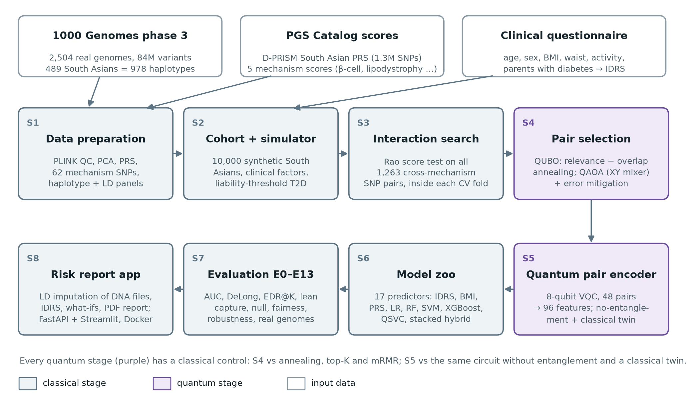
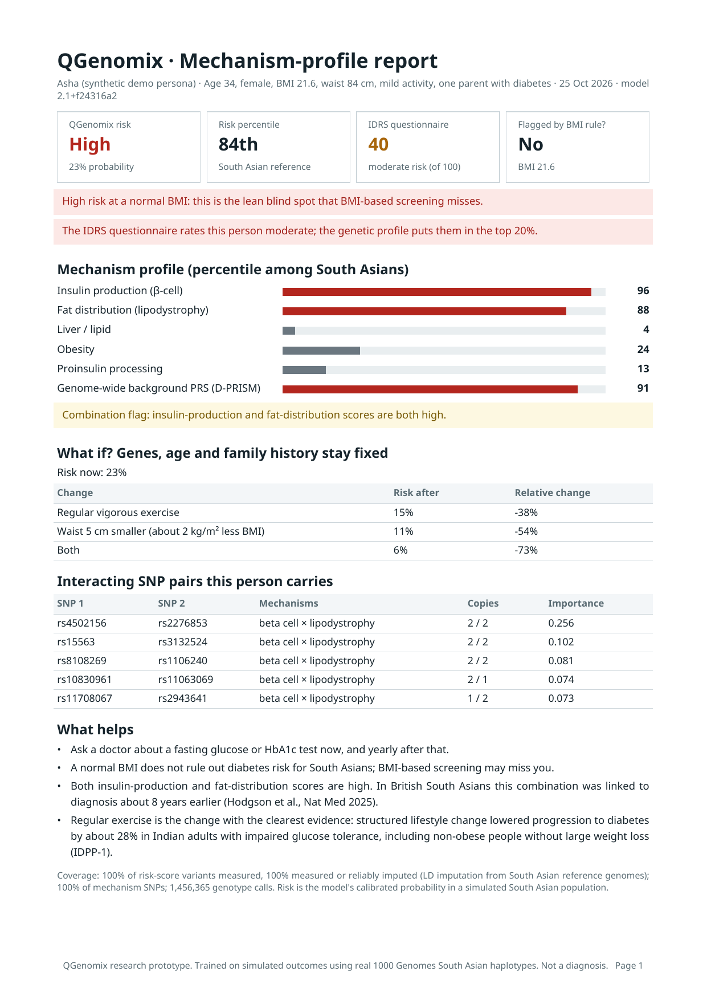

# QGenomix

**Quantum-assisted genetic screening for early-onset type 2 diabetes in lean South Asians.**

Many South Asians develop type 2 diabetes young and at a normal BMI, so BMI-based screening misses them.
QGenomix asks two questions: do genetic variants from two diabetes mechanisms, insulin production (β-cell)
and fat distribution (lipodystrophy), *interact*, and how much do genes add to India's clinical screening
score (IDRS)? It searches for gene pairs with a QUBO solved classically and by QAOA, encodes them with a
variational quantum circuit, benchmarks every quantum step against a classical control, and serves the result
as a mechanism-profile risk report with validated lifestyle what-ifs. Partial consumer DNA files (23andMe,
AncestryDNA) are completed by LD imputation, the report downloads as a PDF, and the app ships as a Docker image.

> Research prototype. Genotypes are real (1000 Genomes); disease outcomes are **simulated**. Not a medical
> device and not for diagnosis.



**Headline results** (simulated outcomes on real genotypes): adding genetics to the clinical factors raises AUC
from 0.812 to 0.874; among lean people who develop diabetes, screening the top 20% by risk catches 58% with
genetics against 30% with the IDRS and 0% with a BMI rule; the interaction search finds 70-84% of planted gene
pairs (PLINK BOOST 40-48%); the quantum components show no advantage over their classical controls, and error
mitigation recovers most of the quality lost to hardware noise.

## Team

| Name | Roll No. |
| --- | --- |
| Aritro Chowdhury | 102303452 |
| Suyash Gupta | 102303017 |
| Rishabh Sharma | 102303286 |
| Akshat Ahuja | 102315073 |
| Anshh Pasriccha | 102303455 |

Guided by **Dr. Husanbir Singh Pannu**, Assistant Professor, Computer Science and Engineering Department,
Thapar Institute of Engineering and Technology, Patiala.

## Documents

| File | What it is |
| --- | --- |
| [`QGenomix_Mentor_Evaluation_Report.docx`](QGenomix_Mentor_Evaluation_Report.docx) | Project report: requirements, method, design, all experiments and results |
| [`QGenomix_Presentation.pptx`](QGenomix_Presentation.pptx) | 16-slide presentation with speaker notes |
| [`docs/model_card.md`](docs/model_card.md) | Intended use, data, performance, fairness and limits of the deployed model |
| [`docs/HANDOVER.md`](docs/HANDOVER.md) | How to run the demo and what remains |
| [`docs/resume_highlights.md`](docs/resume_highlights.md) | Project summary lines for CVs |

## What is in the box

| Stage | Module | What it does |
| --- | --- | --- |
| S1 | `qgenomix.data.prepare`, `impute` | 1000 Genomes QC, PCA, D-PRISM PRS, mechanism SNPs, South Asian haplotype library, LD imputation panel |
| S2 | `qgenomix.data.cohort`, `qgenomix.sim`, `qgenomix.clinical` | Synthetic South Asians as haplotype mosaics; clinical factors and IDRS; liability-threshold outcome simulator |
| S3 | `qgenomix.search.relevance` | Rao score test for all 1,263 cross-mechanism pairs, inside each CV fold |
| S4 | `qgenomix.search.qubo`, `solvers`, `qaoa`, `mitigation` | QUBO pair selection (annealing + swap polish); QAOA (penalty and Dicke/XY forms); readout correction, post-selection, zero-noise extrapolation |
| S5 | `qgenomix.quantum` | 8-qubit pair circuit, exact fast simulator, encoders, fidelity kernel |
| S6 | `qgenomix.models.zoo` | 17 predictors, from the IDRS questionnaire to the quantum stack |
| S7 | `qgenomix.eval`, `qgenomix.pipeline` | AUC, EDR@K, lean-case capture, DeLong, McNemar; experiments E0 to E13 |
| S8 | `qgenomix.app` | Model bundle, genotype parser (23andMe, AncestryDNA) with LD imputation, FastAPI, Streamlit dashboard with what-ifs, PDF report, Docker, synthetic personas |

## Quick start

```bash
make setup        # Python 3.12 venv with CPU torch and all dependencies (uses uv)
make test         # unit, equivalence, smoke and app tests; the app tests are skipped until `make bundle`
```

Full pipeline (needs the raw data below, about 2 to 3 hours on a 16-core laptop; keep it from sleeping):

```bash
make data         # S1: data/raw -> data/processed
make experiments  # E0-E9 -> results/*.json
make bundle       # train the deployable model -> bundle/
make impute       # LD imputation panel for partial consumer DNA files -> bundle/impute_panel.npz
make e10          # lifestyle what-if check against the simulator's truth
make extras       # E7b error mitigation, E11 fairness, E12 robustness, E13 imputation
make figures      # -> figures/*.png, results/tables.json
make personas     # three synthetic demo genomes -> data/personas/
make app          # Streamlit on http://localhost:8501 (restart after rebuilding the bundle)
                  # demo link: http://localhost:8501/?persona=asha_lean_high&autorun=1
make api          # FastAPI on http://localhost:8000/docs (POST /v1/profile, POST /v1/report.pdf)
make docker       # both in containers: docker compose up --build
```

### Raw data

* `tools/plink2`, `tools/plink`: PLINK 2 and PLINK 1.9 Linux binaries from cog-genomics.org.
* `data/raw/1kg/`: from the PLINK 2 resources page, `all_phase3.pgen.zst`, `all_phase3_noannot.pvar.zst`
  (rename to `all_phase3.pvar.zst`) and `phase3_corrected.psam` (rename to `all_phase3.psam`).
* `data/raw/pgs/`: PGS Catalog harmonised GRCh37 scoring files `PGS005115`–`PGS005119` (mechanisms) and
  `PGS005373`–`PGS005377` (D-PRISM, trained for South Asians), named `<ID>_hmPOS_GRCh37.txt.gz`.

### Real quantum hardware (optional)

`scripts/run_ibm.py` samples the trained QAOA circuits on IBM hardware with a free IBM Quantum Open Plan
account (10 QPU minutes per 28 days; this uses one to two). It applies the same error mitigation as E7b plus
dynamical decoupling and gate twirling. Save your API key on your own machine as the script header shows, never
in this repository. `make rehearse-ibm` runs the whole script locally on the IBM Kingston noise model first.

## Results (10,000 synthetic South Asians unless stated)

| Experiment | Result |
| --- | --- |
| E1 prediction | IDRS questionnaire AUC 0.761, clinical factors 0.812, PRS only 0.736; clinical + PRS + mechanisms 0.874 (genes add +0.063, p < 0.001). Quantum variants 0.866-0.871, no significant gain |
| E2 interaction discovery | Score test finds 70-84% of planted pairs in its top 10 at δ = 0.2; PLINK BOOST 40-48% |
| E3 sample size | 24% of pairs found with 2,500 people, 78% with 10,000, 92% with 20,000 |
| E4 null | 18 of 20 null runs report nothing, 2 report one false pair; p-values calibrated (λ = 1.05) |
| E5 entanglement | Entangled VQC 0.866, no entanglement 0.871, classical twin 0.870 (own heads) |
| E6 pair selection | QUBO covers 62 SNPs (top-K 49), cuts shadow pairs by a quarter, best objective in 61% of runs |
| E7 QAOA | Constraint-preserving XY mixer 0.76→0.83 (depth 1→6) vs penalty form 0.30→0.66, ideal; IBM Kingston noise model ~0.3 for both |
| E7b error mitigation | On the IBM Kingston noise model, readout correction + post-selection + zero-noise extrapolation lift the XY QAOA from 0.31 to 0.75 (noise-free 0.76, random valid choice 0.68); the penalty form only reaches 0.69 |
| E8 lean blind spot | Lean cases caught in the top 20%: BMI rule 0%, IDRS 30%, clinical model 35%, with genes 58% |
| E9 real genomes | Clinical + genes AUC 0.881 on real South Asians, 0.792 on Africans |
| E10 lifestyle what-ifs | App vs truth: waist −5 cm −28% vs −28%; exercise −32% vs −40%; both −52% vs −59% |
| E11 fairness | Clinical + genetics beats clinical in all 5 South Asian populations and both sexes; AUC 0.84 (Punjabi) to 0.92 (Tamil, Telugu); calibration equal across groups |
| E12 robustness | Under 13 alternative simulator settings, genetics beats clinical factors in 13/13 (AUC +0.04 to +0.08) and beats IDRS on lean cases in 13/13; planted-pair discovery ranges 25-95% with effect size |
| E13 partial DNA files | At 45% coverage, LD imputation: PRS r 0.95 → 0.98, risk-percentile error 13 → 6 points, high-risk people kept 54% → 80% |

Every number comes from `results/*.json`; `results/tables.json` is the summary and `figures/` holds the plots.
Results from before the clinical factors were added are kept in `results/v1_pre_clinical/`.

## The application

The dashboard reads a 23andMe or AncestryDNA file, fills in missing variants, and reports the risk tier and
percentile, the IDRS, the screening flags the BMI rule and the IDRS would miss, the mechanism profile with the
gene pairs that drive it, and live lifestyle what-ifs. The same report downloads as a one-page PDF:



## Repository layout

```
configs/      main.yaml: every parameter; results record its hash
src/qgenomix/ the package (data, sim, search, quantum, models, eval, pipeline, app)
scripts/      prepare_data, run_experiments, make_figures, build_bundle, build_impute_panel, make_personas, run_ibm
tests/        unit, equivalence, smoke and app tests
docs/         model_card.md, HANDOVER.md, resume_highlights.md; report/ and presentation/ rebuild the
              report (.docx) and the slides (.pptx) from results/
Dockerfile    app image (dashboard + API); docker-compose.yml runs both
results/      experiment outputs (JSON)
figures/      report figures
```
